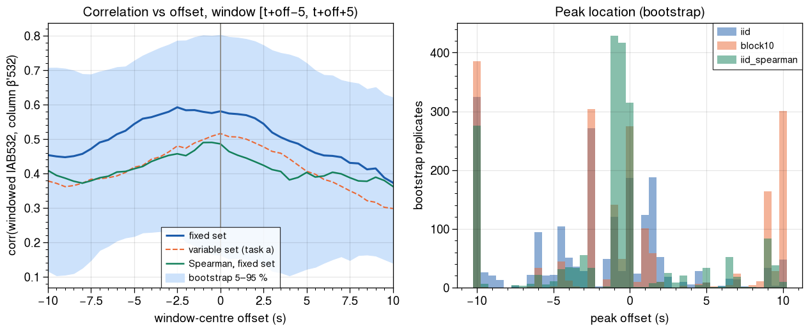
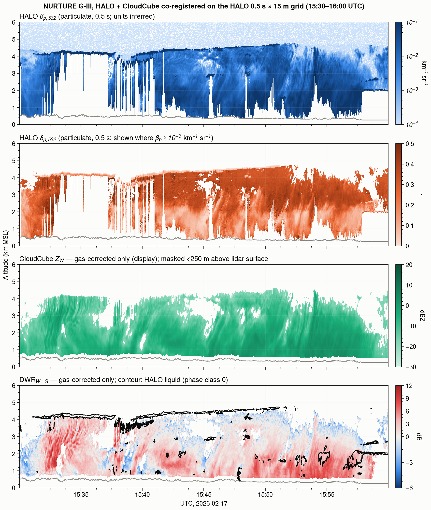

# Follow-up (b) — HALO 10 s window offset sweep, window bookkeeping, 0.5 s co-registration

*2026-10-20. Appendix A §A.8(5b); `[GAP G23]`, `[OPEN O29]`, `[OPEN O36]`. Scripts: `scripts/followup_b_window.py` → `followup_b_window.json`, `followup_b_window_sweep.csv`, `figures/followup_b_window.png`; `scripts/build_coreg_0p5s.py` → `<cache_dir>/coreg_20260217_1530-1600_0p5s.nc`; `scripts/stm_fourpanel.py --0p5s` → `figures/stm_20260217_1530-1600_0p5s.png`.*

## 1. Offset sweep

**Test.** For a 10 s window $[t + o - 5, t + o + 5)$, with $o$ from −10 to +10 s in 0.5 s steps, correlate the window mean of C&S `IAB532` (NaN → 0) with column-integrated HALO $\beta'_{532}$.

**Profiles.** The same 273 heterogeneous profiles as task (a), using task (a)'s definition (recovered from the 2026-10-14 session): std/mean of `IAB532` in $[t-10, t+10)$ > 0.5 and mean > 0.005.

**Two profile sets:**
- **variable:** task (a)'s selection, both values > 0.003 at each offset; 229–256 profiles;
- **fixed:** the same 155 profiles at every offset, so the curve compares like with like.

Uncertainty of the peak location comes from 2,000 bootstrap resamples of the fixed set (i.i.d. and 10-profile moving blocks).

| Metric | Peak offset | Value at peak | Value at 0 s | Half-drop width |
|---|---|---|---|---|
| Pearson, variable set (task a) | 0.0 s | 0.516 | 0.516 | — |
| Pearson, fixed set | −2.5 s | 0.592 | 0.580 | −7.0 to +4.5 s |
| Spearman, fixed set | −0.5 s | 0.490 | 0.486 | −4.0 to +2.0 s |

"Half-drop width" is the full width over which the curve stays above the midpoint between its peak and its minimum over ±10 s.

| Bootstrap peak location (2.5 / 50 / 97.5 %) | Fraction within ±1 s |
|---|---|
| Pearson, i.i.d.: −10 / −2.5 / +9.5 s | 0.24 |
| Pearson, 10-profile blocks: −10 / 0 / +10 s | 0.29 |
| Spearman, i.i.d.: −10 / −0.5 / +9 s | 0.58 |

**Reading.**
- All three curves peak within −2.5 to 0 s and fall off by ±5 s, so the sweep is consistent with the centered window $[t-5, t+5)$.
- The curves are broad, and the differences near the peak (≈0.01) are far smaller than the sampling spread: the bootstrap 5–95 % band at any offset spans ≈0.13–0.81.
- The peak location is not determined. Its bootstrap 95 % interval covers almost the whole ±10 s sweep. Even the rank correlation, which is less sensitive to a few large-`IAB532` profiles, puts only 58 % of replicates within ±1 s.
- **This test cannot resolve the offset to ±1 s (or to a few seconds).** The 2026-10-14 statement "alignment resolved to about ±1 s" is not supported; v1.11's "offset resolution not established" stands. A sharper test needs a quantity that changes within a window, e.g. the PI's 0.5 s file or the PI's own description of the averaging.

## 2. Window bookkeeping ([t − 5 s, t + 5 s))

| | Whole flight | 15:30–16:00 |
|---|---|---|
| HALO profiles | 1,689 | 179 |
| Windows without 20 sub-profiles | **79** (59 with 19; 19 with 8–18; 1 with 21) | 10 (all 19) |
| Sub-profiles with duplicate time stamps | 0 (all counts are of distinct sub-profiles) | 0 |
| Consecutive pairs with spacing < 10 s | 236 | 19 |
| … of which actually share ≥ 1 sub-profile | 183 | 12 |
| Sub-profiles in two windows | **190** (max 2 windows) | 12 |
| Sub-profiles in no window (spacing > 10 s) | 341 of 33,765 | 21 of 3,579 |

- Spacing is 9.04–23 s (1–99 %: 9.5–11.5 s).
- The 19-sub-profile windows follow from a 0.501 s C&S cadence against a 10 s window.
- Shared sub-profiles make consecutive rows' errors correlated in time `[O29]`, but only weakly: at most 1 of 20 sub-profiles per pair, 190 in the flight.

## 3. Higher-resolution co-registered file (0.5 s × 15 m)

Grid chosen by Joe (2026-10-20): **C&S 0.5 s sub-profiles × HALO 15 m `z`**, 3,589 × 845. That is 20× finer horizontally than the 10 s file (179 × 845). The vertical stays at 15 m, the finest native lidar grid.

- **Windows.** Each sub-profile takes the CloudCube rays in $[t - 0.2507, t + 0.2507)$ s, half the 0.50138 s spacing, so windows tile without gaps or overlap. That gives 4–5 rays each (5 in 3,559 sub-profiles). That the C&S time stamp is the interval centre is assumed by analogy with the 10 s rule `[G23]`.
- **Radar.** Same as task (d): linear-Z mean over detecting rays (≥ 50 % of rays), `*_all` and `*_detect_frac` kept, gates on the HALO MSL datum `[D23]`, nearest gate per 15 m bin, display gas correction `zgc_*`, `dwr_wg_gc`.
- **C&S.** `Type` (native 0.5 s), `liquid` (class 0), `ice` (classes 1–2), `altSurface`.
- **HALO Aerosol/WV** (`532_total_attn_bsc`, `532_dep`, `Temperature`) exists only at 10 s. Each sub-profile **holds** the 10 s profile whose window contains it; `halo_time` records which one, and `halo_hold` records how it was assigned (1 = inside the window, 2 = nearest).
- **Revision 2026-10-20: blank columns.** The first version left 21 sub-profiles NaN, which showed as thin white columns in the lidar panels.
  - **Cause.** Each one sits in a 10.46–10.5 s HALO step, 5.0–5.5 s from both neighbouring profiles, so it falls 0.02–0.5 s outside both [t − 5, t + 5) windows. A 10.5 s step spans 21 sub-profiles at the 0.50138 s cadence.
  - **Not missing members of short windows.** Flight-wide, 226 of 245 such orphans sit between two full 20-sub-profile windows; only 15 border a 19-count window. Under the working rule they are in no HALO average. Whether HALO skips them or its window is slightly wider than 10 s is not resolved (§1).
  - **The 10 s file was never gap-free in data.** `pcolormesh` stretched each 10 s column to the midpoint between profiles, so the same instants were drawn filled.
  - **Fix (display and diagnostics only).** A sub-profile in no window now holds the nearest profile if it lies within 0.5 s (one sub-profile) of that window's edge: `halo_hold` = 2, here 21 sub-profiles at ≤ 5.23 s from the profile time. Longer HALO gaps (> 11 s; none in this segment, 96 orphans flight-wide) stay NaN, so real data gaps are never filled. Lidar fields are never interpolated between profiles, which would invent structure.
  - **The y-row rule is unchanged.** `coreg.containing_window(..., extend=0)` is still the default, and the 10 s product keeps [t − 5, t + 5).
- **Kept unchanged.** The 10 s file `coreg_20260217_1530-1600.nc`. It is the y-row prototype on the lidar grid and the basis of the PK Ka-coverage numbers (179 × 845). Joe's notebook can switch files by name.
- **Caveats.**
  - With 4–5 rays, the detection-fraction threshold is coarse (0.6 or 0.8 at ≥ 50 %), and partial-detection pixels are censored means of 3–4 rays `[O21]`.
  - The 1-in-3 gate duplication on 15 m is unchanged `[O29]`.
  - Held lidar fields are not 0.5 s information: don't compute radar–lidar ratios at 0.5 s from them.

