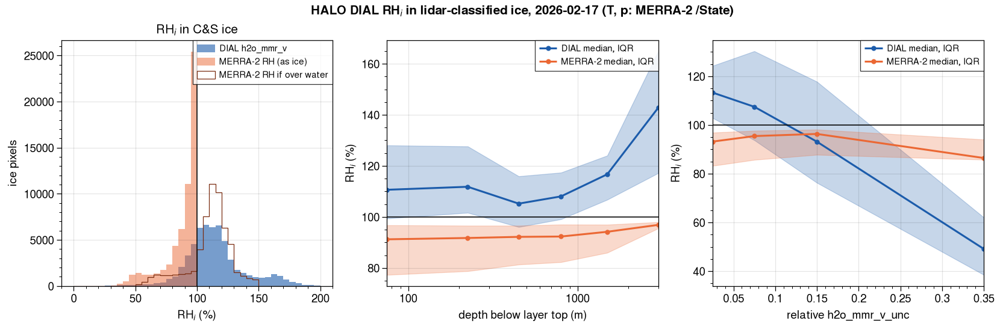

# Follow-up (c) — in-ice DIAL $q_v$ and the `h2o_mmr_v` ice fill fraction (2026-02-17)

*2026-10-20. Appendix A §A.8(5c); `[OPEN O32]`, `[DECISION D7]`, `[GAP G2]`. Script: `scripts/followup_c_dial.py` → `followup_c_dial.json`, figure `figures/followup_c_dial.png`. Thermodynamics: `src/nurture_oe/thermo.py` (Murphy & Koop 2005).*

Ice pixels follow PK's rule: C&S classes 1–2 in ≥ 50 % of the sub-profiles in [t − 5 s, t + 5 s), more than 2.5 km below the aircraft. That gives 62,700 pixels, 58,463 of them with finite `h2o_mmr_v`.

## 1. Fill fraction: 0.932 vs 0.97

**PK's stated definition gives 0.93 under every window tested:**

| Pixel definition | Window | n | Fill |
|---|---|---|---|
| C&S ice | [t − 5, t + 5) | 62,700 | **0.932** |
| C&S ice | [t, t + 10) / [t − 10, t) | 62,337 / 62,425 | 0.930 / 0.928 |
| Class 2 only | centered | 42,788 | 0.933 |
| Ice in all 20 sub-profiles | centered / [t, t + 10) | 34,083 / 34,323 | 0.936 / 0.943 |
| C&S ice with finite `532_total_attn_bsc` | centered | 50,416 | 0.951 |

**Two definitions reproduce 0.97:**

| Pixel definition | n | Fill |
|---|---|---|
| C&S ice in windows where the lidar sees the surface in ≥ 1 sub-profile | 51,004 | **0.969** |
| … where the lidar never sees the surface | 11,696 | 0.774 |
| HALO `Aerosol_ID` = 1 ("Ice") as the ice mask | 45,400 | **0.971** |

- **Conclusion.** The window convention does not explain the difference. 0.932 is the fill fraction under the definition PK records. 0.97 is reproduced either by restricting to windows where the lidar reaches the surface, or by using `Aerosol_ID` = 1 as the ice mask. Which one the 2026-10-06 chat used is not recorded, so this test cannot decide between them. Both 0.97 candidates select columns the lidar penetrates; the DIAL gaps sit in opaque columns.
- **By hour.** The fill also varies along the flight: 0.98 (15 h, 16 h), 0.69 (17 h), 0.95 (18 h), 0.84 (19 h).

## 2. RH$_i$ in ice

**Formula.** $\mathrm{RH}_i = e/e_{si}(T)$ with $e = w\,p/(\varepsilon + w)$, $w$ = `h2o_mmr_v` (g kg⁻¹ → kg kg⁻¹), and $p$ (atm → Pa), $T$ from `/State` (MERRA-2).

**Check.** It reproduces the product's own `RHi_v` to 0.2 % (ratio 0.9965–0.9987, 1–99 %).

**Temperature sensitivity.** In ice, $T$ is 234–261 K (5–95 %), where $d\ln e_{si}/dT = 0.098$ K⁻¹. **A 1 K error in MERRA-2 $T$ moves RH$_i$ by ≈10 %**, so this comparison cannot separate a $q_v$ bias from a few-kelvin $T$ bias.

**MERRA-2 `Relative_Humidity`.** Its saturation reference is not stated (`Description`: "Relative Humidity in percent").
- Empirically its maximum is ≈100 % at 230–270 K, where ice saturation over water would be 69–92 %. That fits a reference over ice (or an ice/liquid blend), not over water.
- It is treated here as RH$_i$. The over-water reading is plotted as an alternative.
- This is inferred, not documented.

| RH$_i$ (%) | n | 5 / 25 / 50 / 75 / 95 % | < 90 % | 90–110 % | > 110 % |
|---|---|---|---|---|---|
| DIAL, all ice | 58,463 | 83 / 101 / **112** / 125 / 166 | 0.09 | 0.36 | **0.55** |
| DIAL, ice with no liquid sub-profile | 57,168 | 83 / 101 / 112 / 125 / 166 | 0.09 | 0.36 | 0.55 |
| MERRA-2 (as ice), same pixels | 58,380 | 53 / 84 / 94 / 97 / 99 | 0.38 | 0.62 | 0.00 |

- DIAL − MERRA-2: 5 / 50 / 95 % = −6 / **+25** / +75 points; correlation 0.24.
- **Against water saturation (added 2026-10-20, wrap-up check).** The same vapour pressure expressed over supercooled water gives RH$_w$ 5 / 25 / 50 / 75 / 95 % = 63 / 79 / **89** / 100 / 144 %. Water saturation corresponds to RH$_i$ = 113 / 125 / 146 % (5 / 50 / 95 %) at these temperatures. **19.5 % of ice pixels exceed RH$_w$ = 105 %.**

**Clear-air control** (C&S class 4 in ≥ 90 % of sub-profiles, $T$ < 0 °C):

| Subset | DIAL − MERRA-2 (5 / 50 / 95 %, points) |
|---|---|
| All clear air (n = 707,992) | −46 / −6 / +31 |
| Clear air within 500 m above ice | −46 / +9 / +50 |

The +25-point excess is specific to ice pixels. It is not a flight-wide DIAL-vs-MERRA-2 offset.

**By depth below the cloud-layer top** (top of the contiguous ≥ 50 %-cloud layer containing the pixel):

| Depth (m) | n | DIAL median (IQR) | > 110 % | MERRA-2 median | Fill |
|---|---|---|---|---|---|
| 0–150 | 10,060 | 111 (99–128) | 0.51 | 91 | 0.95 |
| 150–300 | 7,643 | 112 (102–128) | 0.54 | 92 | 0.95 |
| 300–600 | 10,819 | 105 (96–116) | 0.39 | 92 | 0.92 |
| 600–1000 | 10,597 | 108 (99–117) | 0.44 | 92 | 0.92 |
| 1000–2000 | 13,838 | 117 (107–124) | 0.68 | 94 | 0.94 |
| 2000–4000 | 5,506 | **143** (117–165) | 0.82 | 97 | 0.92 |

RH$_w$ by depth (median; fraction > 110 %): 84 % (0.16), 86 % (0.16), 82 % (0.08), 86 % (0.07), 95 % (0.12), and **127 % (0.62)** at 2–4 km.

The DIAL range cell in ice is 315 m (median at every depth). The top two bins therefore lie within one DIAL cell of the layer top, and the 60 s average spans about 14 km along track.

**By relative `h2o_mmr_v_unc`** (median 2 %; 95th percentile 9 %):

| unc / $q_v$ | n | DIAL median (IQR) | MERRA-2 median |
|---|---|---|---|
| < 5 % | 48,321 | 113 (103–124) | 93 |
| 5–10 % | 7,326 | 108 (94–130) | 95 |
| 10–20 % | 2,138 | 93 (76–118) | 96 |
| 20–50 % | 209 | 49 (39–62) | 86 |
| ≥ 50 % | 20 | 33 | 95 |

Relative uncertainty grows as $q_v$ falls. This trend is therefore partly a selection effect: low-RH pixels have large relative uncertainty by construction. It does not show that low-uncertainty pixels are biased.

**Where the high mode is.** RH$_i$ > 150 % occurs in 6,272 pixels (11 %).
- They are concentrated in 15:30–16:00, the STM transect, where they are 19 % of ice pixels, against 0–14 % in other half-hours.
- They sit 0.5–3.4 km above the DEM at 247–262 K: the snow column beneath the supercooled-liquid layer.

## Evidence, not a verdict

*(Revised 2026-10-20 after the RH$_w$ check; the first version judged against ice saturation only.)*

**Consistent with credible in-ice $q_v$:**
- Fill ≥ 0.92 at every depth, and random uncertainty is small (median 2 %).
- In the upper 2 km of ice layers, RH$_i$ medians of 105–117 % correspond to RH$_w$ medians of 82–95 %. That lies **between ice and water saturation**, the normal state of mixed-phase cloud (Wegener–Bergeron–Findeisen regime) on a TPV transect with supercooled liquid. RH$_i$ > 110 % by itself is therefore not evidence against the DIAL.

**Hard to reconcile with cloud physics at face value:**
- 19.5 % of in-ice pixels exceed RH$_w$ = 105 %. Supersaturation with respect to liquid water beyond a few percent would activate droplets and is not sustained at these scales.
- The excess sits in the deep layers 2–4 km below the top (median RH$_w$ 127 %, 62 % > 110 %), mostly in the low-level snow of the STM segment.
- Candidate explanations, none tested here:
  - a MERRA-2 cold bias: ≈3 K would produce it ($d\ln e_{sw}/dT \approx 0.08$ K⁻¹);
  - DIAL systematic error in cloud (multiple scattering or particulate contamination of the on/off ratio);
  - mixing of liquid-layer vapour into the 315 m / 60 s cells.

**Not checked:** a dropsonde or other in-situ $T$/$q_v$ on 02-17. The 1064 products list dropsondes as their state source, so dropsonde $T$ may exist for this flight. That is the cleanest way to separate $T$ error from $q_v$ error.
