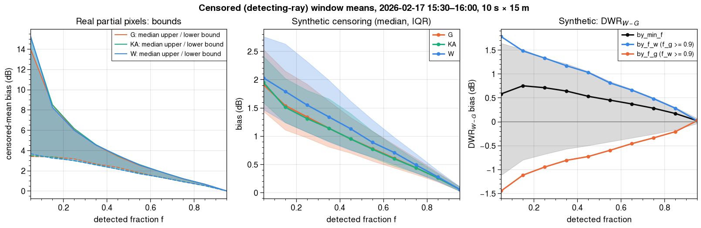

# Follow-up (d) — censored-mean effect in co-registered radar rows (2026-02-17, 15:30–16:00)

*2026-10-20. Appendix A §A.8(5d); `[OPEN O21]`, `[GAP G24]`, `[OPEN O36]`. Script: `scripts/followup_d_censored.py` → `followup_d_censored.json`, `followup_d_censored_{bounds,synthetic,synthetic_dwr}.csv`, figure `figures/followup_d_censored.png`. Grid: task (d), 10 s × 15 m, 179 profiles, 99–100 rays per window.*

## What the cache can and cannot show

- **`*_all` is not an all-ray mean.** In the cache it is the same detecting-ray mean as `zm_*`, without the f ≥ 0.5 threshold, so `zm_* − zm_*_all` = 0 wherever `zm_*` is valid. Non-detecting rays carry no value, so the true (all-ray) window mean is not in the data.
- **Recomputed from the rays.** The values below were recomputed from the CloudCube rays with the current code. They match the 2026-10-14 cache to ≤ 0.06 dB (one ray in detected fraction); the cache predates a minor code change.

**Valid pixels (f ≥ 0.5) that are partial (f < 1):**

| Band | Valid pixels | f < 1 | f < 0.9 | Partial pixels discarded (0 < f < 0.5) |
|---|---|---|---|---|
| Ka | 13,119 | 25 % | 17 % | 7,003 |
| W | 44,437 | 14 % | 9 % | 6,396 |
| G | 40,671 | 16 % | 10 % | 6,746 |

Of the 39,424 pixels where both W and G are valid, 6,511 (17 %) are partial in at least one band.

## Bias of the detecting-ray mean, bounded on the real partial pixels

The bias is $10\log_{10}(\bar Z_{\text{det}} / \bar Z_{\text{all}})$, where $\bar Z_{\text{all}} = f\,\bar Z_{\text{det}} + (1-f)\,\bar Z_{\text{nd}}$. The unknown is $\bar Z_{\text{nd}}$, the mean of the non-detecting rays, which lies between 0 and the detection floor:

- **Upper bound** (non-detecting rays at Z = 0, e.g. a cloud edge): bias $= -10\log_{10} f$, the same for every band.
- **Lower bound** (non-detecting rays at the floor): floor = $Z_{\min}(r)$ from the granule attribute plus the 2026-10-14 offset of the delivered floor (Ka −9.0, W −10.9, G −7.0 dB; 0.1th percentile, 6–9 km range). Because that offset is approximate, so is this bound `[G24]`.

**Medians over pixels (lower – upper bound, dB):**

| f | Ka | W | G |
|---|---|---|---|
| 0.5–0.6 | 1.7 – 2.6 | 1.7 – 2.6 | 1.8 – 2.5 |
| 0.6–0.7 | 1.3 – 1.9 | 1.3 – 1.9 | 1.3 – 1.9 |
| 0.7–0.8 | 0.9 – 1.2 | 0.9 – 1.2 | 0.9 – 1.2 |
| 0.8–0.9 | 0.5 – 0.7 | 0.5 – 0.7 | 0.5 – 0.7 |
| 0.9–1.0 | ≈0 – 0.2 (95th pct) | ≈0 | ≈0 |

The rows above (f ≥ 0.5) are the ones that enter the co-registered fields. Below that the bias grows to 2–4 dB (lower) and 8–15 dB (upper); the `*_all` fields include those pixels.

**DWR$_{W-G}$** on real pixels with both bands valid and at least one partial:
- The bias is bounded by $[\text{low}_W - \text{up}_G,\ \text{up}_W - \text{low}_G]$.
- Per-pixel interval medians: f_min 0.5–0.6: −0.2 to +0.9 dB; 0.7–0.8: +0.1 to +0.4 dB; 0.8–0.9: −0.2 to 0.0 dB.
- Across pixels the interval endpoints span about ±2.5 dB at f_min ≈ 0.5.
- **The sign depends on which band is censored more.** A W-censored pixel biases DWR high; a G-censored pixel biases it low.

## Synthetic censoring (true mean known)

**Test.**
- Pixels where every ray detects (W 38,307, G 34,054, Ka 9,792) have a known all-ray mean.
- Censor rays below $Z_{\min}(r) + \Delta$, with Δ = −12…+12 dB in 1.5 dB steps, and recompute the detecting-ray mean.
- For DWR, censor W and G at the same Δ relative to each band's own $Z_{\min}$.

**Median bias vs resulting detected fraction (IQR in the CSV):**

| f | Ka | W | G | DWR, W partial (f_G ≥ 0.9) | DWR, G partial (f_W ≥ 0.9) |
|---|---|---|---|---|---|
| 0.5–0.6 | 0.77 | 0.89 | 0.78 | +0.81 | −0.60 |
| 0.7–0.8 | 0.44 | 0.49 | 0.44 | +0.48 | −0.34 |
| 0.8–0.9 | 0.26 | 0.28 | 0.26 | +0.28 | −0.21 |
| 0.9–1.0 | 0.06 | 0.06 | 0.06 | +0.02 | +0.02 |

**This is the most favourable case**: a threshold cutting through the lower tail of a strong, spatially continuous echo. The censored rays sit just below the threshold, so the bias is about half the real-pixel lower bound. Real partial pixels sit near cloud edges and in weak echo near the floor. There the missing rays can be far below the floor, and the bounds above apply.

## Reading for S2 (not a decision)

- **The bias is one-sided in Z** (always high) and grows roughly like $-10\log_{10} f$ at cloud edges. It is ≥ 0.5 dB once f < 0.9 and ≥ 1.7 dB at f ≈ 0.5 under the floor-based lower bound. That is well above the ≈0.03 dB random term of a 100-ray mean and comparable to plausible calibration terms `[O31]`.
- **The current rule (f ≥ 0.5) therefore admits rows biased by up to ~2.5 dB.** Restricting rows to f ≥ 0.9 keeps the bias ≲ 0.2 dB (95th percentile; synthetic median 0.06 dB). It drops 9 % (W), 10 % (G) and 17 % (Ka) of currently valid pixels. Treating 0.5 ≤ f < 0.9 with a censored likelihood is O21's alternative.
- **For DWR the bias has either sign**, set by which band is censored more. It cannot be absorbed by a one-sided penalty on a single band.
- **Limits.**
  - One 30 min segment.
  - The floor offset is a single-number approximation `[G24]`.
  - The synthetic test does not reproduce edge geometry.
  - Representativeness (`[O36]`) is a separate error that also grows at edges.
