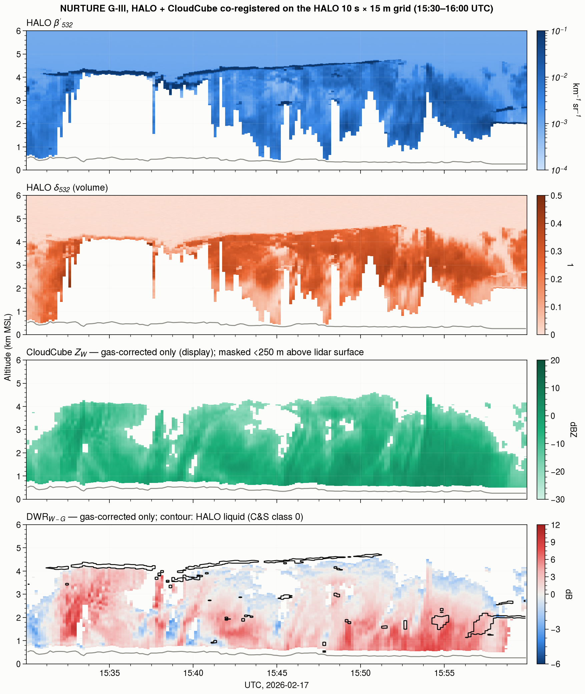

# Task (d) — STM co-registration and Ka coverage, 2026-02-17 15:30–16:00 UTC

*2026-10-14. Code: `src/nurture_oe/coreg.py`, `src/nurture_oe/checks/ka_coverage.py`; drivers `scripts/run_task_d.py` (cache + tables) and `scripts/stm_fourpanel.py` (figure). Scope: appendix A §A.8(4), §A.11(b).*

**Outputs**

| File | Contents |
|---|---|
| `<cache_dir>/coreg_20260217_1530-1600.nc` | 179 profiles × 845 bins, with provenance attrs |
| `docs/reports/figures/stm_20260217_1530-1600.png` | the four-panel figure |
| `docs/reports/ka_coverage_*_20260217_1530-1600.csv` | Ka coverage: summary, by range, clearance sweep |

## Method

1. **Target grid.** The HALO Aerosol/WV 10 s profiles × 15 m `z` (MSL). Only profiles whose whole window lies inside 15:30:00–16:00:00 are kept: 15:30:07–15:59:51.5, 179 profiles.
2. **Time matching.** Each HALO profile at time t takes everything in **[t − 5 s, t + 5 s)**. That is 20 C&S sub-profiles and 99–100 CloudCube rays per window. The window rule is empirical (task (a) report).
3. **Slant range → altitude.**
   - Off-nadir: $\cos\theta = -\mathbf{l}_{\text{ECEF}}\cdot\hat{u}$, with $\hat{u}$ the geodetic local-up vector.
   - Gate altitude: $z = \text{alt}_{\text{ref}} - r\cos\theta$.
   - $\text{alt}_{\text{ref}}$ is **HALO `gps_alt` (MSL)** interpolated to ray times, not CloudCube `alt`. The latter is ellipsoidal and here sits 38 m lower (the geoid undulation), about two gates.
   - On this straight leg θ ≈ 2.4° (pitch-driven) and roll < 0.7°.
   - Each HALO bin takes the nearest gate in altitude for each ray (20 m gates on 15 m bins); no values are interpolated. Gates at r < 0 are not used.
4. **Aggregation.** For each band, the mean is taken in linear Z over the rays in the window that detect (finite `zm`), then converted to dBZ.
   - A pixel is valid when ≥ 50 % of its rays detect. `*_detect_frac` and `*_all` (no threshold) are kept.
   - Averaging in linear Z matches what a forward model computes for a volume, and keeps the radar sample on the same 10 s, about 2.4 km footprint as the lidar `[O36]`. Each window averages about 100 rays, so the random error per pixel is much smaller than the single-ray 0.33 dB. But neighbouring 15 m rows share 20 m gates, so their errors are correlated `[O29]`. Decimate to independent rows before building $\mathbf{S}_\epsilon$.
5. **Phase masks.** C&S `CloudMask/Type` fractions per window: liquid = class 0 in ≥ 50 % of sub-profiles; ice = classes 1–2 in ≥ 50 % (appendix A §A.10.5).
6. **Display gas correction.** $Z_{gc}(r) = z_m + 2\int_0^r k_{\text{atten}}\,dr'$. `katten` is one-way, in dB km⁻¹, integrated by the trapezoid rule from the aircraft and applied per ray before aggregation. It is used for panels 3–4 only; `zm` enters $\mathbf{y}$ as delivered. Two-way gas attenuation at 1 km altitude is about **1.3 dB at W and 5.9 dB at G** (median), so near the surface about 4.7 dB of DWR_W−G is gas alone.

## Figure

1. HALO $\beta'_{532}$ (`532_total_attn_bsc`).
2. HALO $\delta_{532}$ (`532_dep`).
3. CloudCube $Z_W$, gas-corrected only (display).
4. DWR_W−G, gas-corrected only, with the C&S liquid boundary (class 0) as a black contour.

The gray line is the lidar surface (window mean of C&S `altSurface`; gaps after 15:58 interpolated and held). Radar pixels within **250 m of the lidar surface are hidden in the display** (surface clutter; display-only choice). The aircraft is at 12.0 km MSL; the y-axis is cut at 6 km.

**Reading the figure.** A supercooled-liquid-topped layer at 4.1–4.7 km (bright $\beta'$, low δ; the liquid contour sits on top) caps a depolarizing ice/snow column (δ ≈ 0.3). The radar follows the column to the ground with fall streaks. The lidar is extinguished within a few hundred metres of the liquid top or about 1–3 km into the ice. DWR_W−G grows downward to 6–10 dB in the lowest 2 km.

**Slide framing (§A.8(4)).** DWR_W−G here mixes particle size with differential attenuation: about 4.7 dB from gas near the surface (W 1.3 vs G 5.9 dB two-way), plus supercooled liquid at the layer top, which attenuates G more than W. The figure shows the rows of $\mathbf{y}$, not retrieval products. The joint framework separates size from attenuation through $F(\mathbf{x})$, which carries both gas and liquid paths (`index.md` §4.1).

## Ka coverage check `[OPEN O15]` condition 3

**Definitions.**
- Denominator: ice pixels (C&S rule) where both W and G are valid (≥ 50 % of rays detect), above the lidar surface.
- Numerator: those pixels where Ka also detects, meaning the window-mean $Z_{Ka} > Z_{\min}^{Ka}(r) = Z_{1\,\mathrm{km}} + 20\log_{10}(r/1\,\mathrm{km})$, with r the mean slant range of the mapped gates.

| Ka detection definition | Ice pixels (W & G detected) | Ka also detects | Fraction |
|---|---|---|---|
| Z > Z_min, **file attribute (−16.32 dBZ)** — governs | 18,944 | 752 | **4.0 %** |
| Z > Z_min, PK (−19.26 dBZ) | 18,944 | 2,066 | 10.9 % |
| finite `zm_ka` (processor detection) | 18,944 | 2,433 | 12.8 % |

- **Temperature.** All 18,944 pixels are below 0 °C (HALO `/State` MERRA-2), so O15's above-melting-layer condition holds throughout.
- **By slant range.** No W & G ice pixels exist below 6 km range (the ice is below about 6 km altitude). Ka coverage is 0 % at 6–8 km and 0–1.8 % at 8–10 km. At 10–12 km, i.e. the lowest about 2 km above ground, it is 14 % (file), 36 % (PK) and 42 % (finite).
- **Clearance above the lidar surface** (file / PK thresholds):

  | Clearance | Coverage |
  |---|---|
  | 0 m | 4.0 / 10.9 % |
  | 120 m | 3.8 / 10.7 % |
  | 250 m | 3.3 / 10.3 % |
  | 500 m | 2.2 / 8.6 % |
  | 1000 m | 0.8 / 4.3 % |

  Ka detections are therefore mostly real low-level snow, not surface clutter alone.

**Interpretation.** On this TPV transect, Ka adds rows only in the lowest about 1–2 km of snow, where particles are largest. The weak, small-particle ice in the upper column, where the triple-frequency density/riming signal would be wanted, is below Ka sensitivity. Under the file's −16.32 dBZ, Ka covers 4 % of the W+G ice pixels. Elsewhere Ka can contribute only through the non-detection penalty `[O21]`.

Note that the delivered `zm` extends 5–11 dB below the stated $Z_{\min}(r)$ in every band (task (a) report). The "sensitivity @ 1 km" is therefore not the delivered detection threshold, and the "finite" row is the processor's own detection. Which definition the O15 test should use depends on the SNR definition behind the sensitivities `[G24]`.

## Caveats and open items

- **Window rule.** Empirical, resolved to about ±1 s `[G23]`. Results are insensitive at that level.
- **Datum and offsets.** The datum correction assumes HALO and CloudCube share the aircraft reference point. The antenna lever arm is unknown; the surface residuals are −11 m (this segment) and +7 m (19:00 segment), within ±1 gate.
- **Gas correction.** Display-only. The MERRA-2 absorption model behind `katten` is unstated `[G24]`.
- **Near-surface radar.** Pixels within about 250 m of the surface carry clutter. The Ka table includes them; the clearance sweep bounds their effect.
- **Second segment.** The 19:00–19:25 granule (Ka −19.26 dBZ, higher Ka fill of 21 %) would be a useful second test. Same code; `run_task_d.build()` would need the granule as an argument (it is fixed to the 15:21 granule now).
